<!--
  Profile README: repo must be named EXACTLY your username (aalindmukati/aalindmukati) and be public.
  Assets in this repo: info-card.svg, wordmark.svg, contrib-heatmap.svg (refreshed daily by the workflow).
  Widths 370 / 490 keep the info card and the 3D wordmark at the same visual height.
-->

<table>
<tr>
<td valign="top"></td>
<td valign="top"></td>
</tr>
</table>

 
 

<h3><code>aalindmukati@github ~ $ ./contributions.sh</code></h3>

 
 

<h3><code>aalindmukati@github ~ $ ./projects.sh</code></h3>

| Project | What it is |
|---|---|
| [**JavaBites**](https://github.com/aalindmukati/Java-Bites)|Unified SRM campus app: attendance, grades and food court in one place |
| [**Ps-Games-Dataset-Analyzer**](https://github.com/aalindmukati/Ps-Games-Dataset-Analyzer) | Exploratory analysis of a PlayStation games dataset (Python) |
| [**Weather-Data-Project**](https://github.com/aalindmukati/Weather-Data-Project) | Weather data analysis (Python) |

<!-- Link ChainTrace and Varsity to their repos once public: [**ChainTrace**](https://github.com/aalindmukati/<repo>) -->

 

<h3><code>aalindmukati@github ~ $ ./stack.sh</code></h3>

 

<h3><code>aalindmukati@github ~ $ ./links.sh</code></h3>

<b>Engineering Student · ML &amp; Quant · AI Security</b>

 

 

